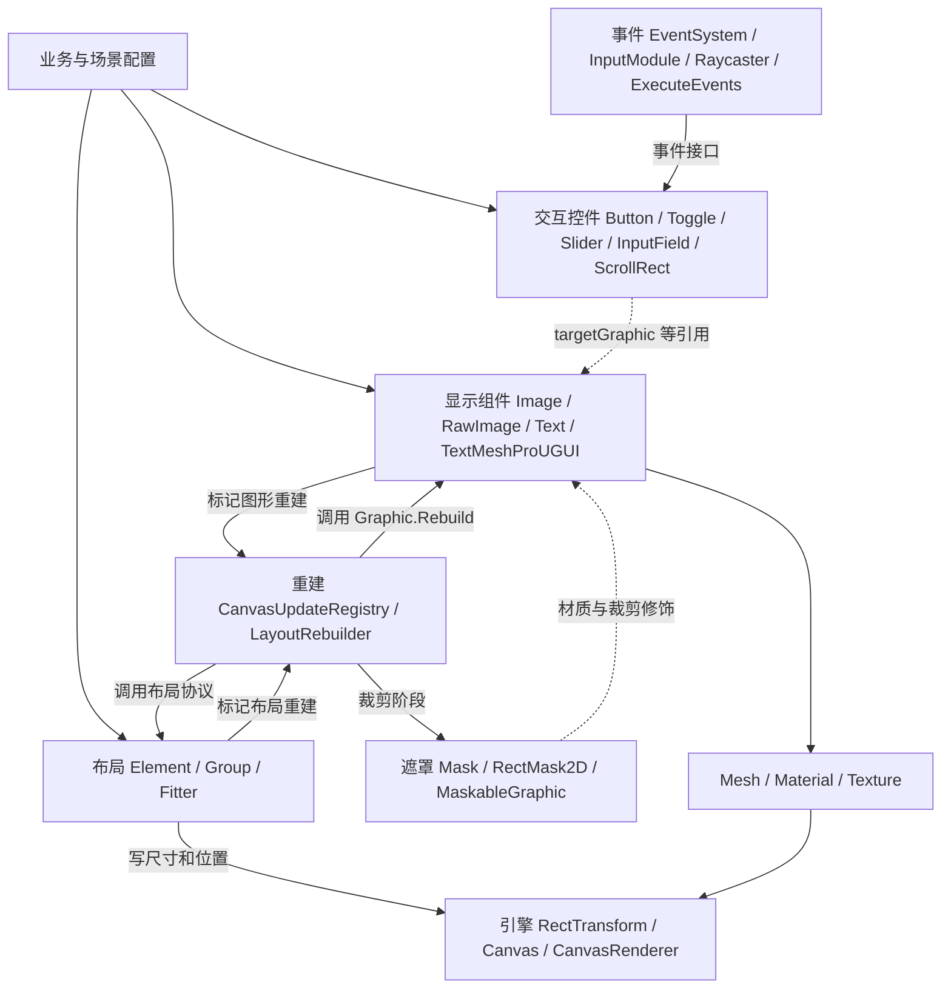

# UGUI 整体架构：组件、协议和调度

> 源码范围：`Packages/com.unity.ugui`，版本 2.0.0；项目 Unity 6000.0.49f1。本文从本地实现归纳架构，配套图见 [UGUI-架构图.html](UGUI-架构图.html) 的“整体架构”和“类与组件”视图。

## 1. 先理解 UGUI 在做什么

UGUI 是围绕 **GameObject 和 Component** 组织的保留式 UI 系统。场景中长期存在的组件保存文字、图片、布局与交互状态；修改状态后，由各子系统在合适的阶段更新布局、网格和材质。普通 Graphic 并不依靠每帧执行自己的 `Update()` 来重画全部内容。

它的整体组织方式可以归纳为：

1. **层级是场景树**：RectTransform 提供位置和尺寸关系，Canvas 提供 UI 所属的绘制环境。
2. **能力以组件组合**：显示、交互、布局、裁剪通常由不同组件承担。
3. **协作以小接口连接**：布局询问 `ILayoutElement`，事件寻找 `IPointerClickHandler`，材质处理寻找 `IMaterialModifier`。
4. **变化以标脏和注册连接到调度**：先合并更新需求，再统一处理。
5. **C# 生成绘制数据，引擎完成底层绘制**：包内可追到 Mesh、Material、Texture 提交，不能在这里读到完整原生批处理实现。

这五点比一开始记住每个控件的全部字段更有助于阅读源码。

## 2. 物理目录与程序集

```text
com.unity.ugui/
├─ Runtime/
│  ├─ UGUI/
│  │  ├─ EventSystem/              事件协议、输入模块、射线检测与分发
│  │  │  ├─ EventData/             一次事件及指针的上下文
│  │  │  ├─ InputModules/          输入采样与指针状态机
│  │  │  ├─ Raycasters/            通用／物理射线检测器
│  │  │  └─ UIElements/            与 UI Toolkit 的事件桥接
│  │  └─ UI/
│  │     ├─ Core/                 Graphic、控件、遮罩、注册表
│  │     │  ├─ Layout/            布局协议、控制器、重建器、CanvasScaler
│  │     │  ├─ Culling/           裁剪协议及注册表
│  │     │  ├─ MaterialModifiers/ 材质扩展协议
│  │     │  ├─ VertexModifiers/   网格扩展及 Shadow / Outline
│  │     │  ├─ Utility/           VertexHelper 等
│  │     │  └─ SpecializedCollections/ IndexedSet
│  │     └─ Animation/            CoroutineTween 等
│  └─ TMP/                       TextMeshPro 文字、字体资源、输入框等
├─ Editor/
│  ├─ UGUI/                      Inspector、菜单、布局预览等编辑工具
│  └─ TMP/                       字体资源工具及 TMP 编辑器
├─ Tests/                        Runtime / Editor，分别覆盖 UGUI / TMP
├─ Documentation~/               使用文档、组件参考和 TMP 文档
├─ Editor Resources/             编辑器资源
└─ Package Resources/            包附带资源
```

注意：`GraphicRaycaster.cs` 在 `UI/Core`，不在 `EventSystem/Raycasters`。目录位置表达其 UGUI 图形依赖，但它在职责上属于事件命中检测。

| 程序集 | 作用 | 源码依据 |
| --- | --- | --- |
| UnityEngine.UI | UGUI 运行时；`UnityEngine.UI` 与 `UnityEngine.EventSystems` 两个主要命名空间 | [Runtime/UGUI/UnityEngine.UI.asmdef](../Packages/com.unity.ugui/Runtime/UGUI/UnityEngine.UI.asmdef) |
| UnityEditor.UI | UGUI 编辑工具，仅 Editor；显式引用 UnityEngine.UI | [Editor/UGUI/UnityEditor.UI.asmdef](../Packages/com.unity.ugui/Editor/UGUI/UnityEditor.UI.asmdef) |
| Unity.TextMeshPro | TMP 运行时，主要命名空间 TMPro | [Runtime/TMP/Unity.TextMeshPro.asmdef](../Packages/com.unity.ugui/Runtime/TMP/Unity.TextMeshPro.asmdef) |
| Unity.TextMeshPro.Editor | TMP 编辑工具 | [Editor/TMP/Unity.TextMeshPro.Editor.asmdef](../Packages/com.unity.ugui/Editor/TMP/Unity.TextMeshPro.Editor.asmdef) |

下文画的是**职责依赖图**，不是逐字转换 asmdef 的引用图。例如本地 TMP 的 asmdef 中 `references` 是空数组，但其 C# 类型明确继承 `MaskableGraphic`；不要把图中的类型依赖误解成该文件中的显式程序集引用声明。

## 3. 职责总图



每个子系统都围绕同一批 GameObject 工作。框架没有要求一个统一的“UI 节点大类”同时处理所有能力，而是用场景层级、组件查询、对象引用和注册表建立联系。

## 4. 引擎层：包与底层的分界

| 类型 | 在架构中的职责 | 包内可以观察到的调用 |
| --- | --- | --- |
| RectTransform | anchors、pivot、sizeDelta、位置、尺寸与父子坐标关系 | LayoutGroup / Fitter 写入属性，Graphic 读取 rect |
| Canvas | UI 绘制环境、渲染模式、排序相关属性，以及渲染前回调 | Registry 订阅 `willRenderCanvases`，Scaler 订阅 `preWillRenderCanvases` |
| CanvasRenderer | 接收单个图形的网格、材质、纹理、裁剪状态 | `SetMesh`、`SetMaterial`、`SetTexture`、`EnableRectClipping` |
| CanvasGroup | 提供整组 alpha、interactable、blocksRaycasts 等状态 | Selectable 检查可交互性，Graphic.Raycast 检查过滤条件 |

这些类型由引擎提供，其实现不在当前包。包内可以证明“C# 把什么交给了引擎”，无法仅凭这些文件证明底层如何建批、具体生成几次 draw call、采用何种 GPU 提交算法。

Canvas 的 Screen Space Overlay、Screen Space Camera、World Space 模式提供不同空间／相机环境，但上层仍然使用 Graphic、布局接口和事件接口。`CanvasScaler` 调整缩放和像素基准，不是自动布局树的遍历器。本版本它在 `OnEnable()` 中订阅 `Canvas.preWillRenderCanvases`，不能照搬“Scaler 每帧在 Update 中执行”的旧描述。

入口：[CanvasScaler.OnEnable / Handle](../Packages/com.unity.ugui/Runtime/UGUI/UI/Core/Layout/CanvasScaler.cs#L237)、[Graphic.UpdateMaterial / UpdateGeometry](../Packages/com.unity.ugui/Runtime/UGUI/UI/Core/Graphic.cs#L669)。

## 5. 显示层：Graphic 把状态变成绘制数据

### 5.1 核心继承关系

```text
MonoBehaviour
└─ UIBehaviour
   ├─ Graphic : ICanvasElement
   │  └─ MaskableGraphic : IClippable, IMaskable, IMaterialModifier
   │     ├─ Image : ILayoutElement, ICanvasRaycastFilter, ...
   │     ├─ RawImage
   │     ├─ Text : ILayoutElement
   │     └─ TMP_Text
   │        ├─ TextMeshProUGUI : ILayoutElement
   │        └─ TextMeshPro（3D 文字分支，采用 MeshRenderer 路径）
   ├─ Selectable
   │  ├─ Button / Toggle / Slider / Scrollbar
   │  ├─ InputField / Dropdown
   │  └─ TMP_InputField / TMP_Dropdown
   ├─ ScrollRect
   ├─ LayoutGroup
   ├─ ContentSizeFitter / AspectRatioFitter / CanvasScaler
   ├─ Mask / RectMask2D
   └─ EventSystem / BaseInputModule / BaseRaycaster / ...
```

此树省略了部分接口和中间基类。例如 HorizontalLayoutGroup、VerticalLayoutGroup 经过 HorizontalOrVerticalLayoutGroup 继承 LayoutGroup。`UIBehaviour` 很薄，主要提供可重写的生命周期与 UI 层级变化回调；它本身没有包办绘制、事件和布局。

依据：[UIBehaviour](../Packages/com.unity.ugui/Runtime/UGUI/EventSystem/UIBehaviour.cs)、[Graphic](../Packages/com.unity.ugui/Runtime/UGUI/UI/Core/Graphic.cs#L81)、[MaskableGraphic](../Packages/com.unity.ugui/Runtime/UGUI/UI/Core/MaskableGraphic.cs#L10)、[TMP_Text](../Packages/com.unity.ugui/Runtime/TMP/TMP_Text.cs#L111)。

### 5.2 Graphic 的四项工作

| 工作 | 核心入口 | 为什么集中在基类 |
| --- | --- | --- |
| 生命周期与所属 Canvas 注册 | OnEnable / OnDisable / 层级变化回调 | 图形启停、换父节点都要维护可查询集合 |
| 标脏与延迟重建 | SetVerticesDirty / SetMaterialDirty / SetLayoutDirty / Rebuild | 各种图形共享调度机制 |
| 图形数据生成与提交 | UpdateGeometry / OnPopulateMesh / UpdateMaterial | 子类只需要提供自己的几何数据或覆盖特殊路径 |
| 射线过滤 | raycastTarget / Raycast | 与 CanvasGroup、Mask 等过滤组件协作 |

Image 根据 Simple、Sliced、Tiled、Filled 类型生成不同几何；RawImage 使用 Texture 和 UV；传统 Text 通过 TextGenerator 获取文字几何。它们复用同一个显示更新骨架。TextMeshProUGUI 则覆盖关键重建与文字生成路径，不能假定它完全走 Image 的 `OnPopulateMesh` 流程。

入口：[Image.OnPopulateMesh](../Packages/com.unity.ugui/Runtime/UGUI/UI/Core/Image.cs#L882)、[Text.OnPopulateMesh](../Packages/com.unity.ugui/Runtime/UGUI/UI/Core/Text.cs#L658)、[TextMeshProUGUI.Rebuild](../Packages/com.unity.ugui/Runtime/TMP/TextMeshProUGUI.cs#L214)。

### 5.3 两个独立的扩展切口

`IMeshModifier` 修饰顶点／三角形数据，典型实现是 Shadow、Outline；`IMaterialModifier` 修饰最终材质，典型使用者是 Mask 与 MaskableGraphic。Graphic 分别在生成 Mesh 和获取 `materialForRendering` 时查询同对象组件，避免把所有特效写死到 Image 中。

这是一种按职责划分的扩展链：**几何效果改变绘制形状，材质效果改变渲染状态**。多个修饰器的顺序有实际影响。

## 6. 布局层：先报告需求，再分配空间

布局系统把“需要多大”与“实际放在哪里”分开：

| 协议／组件 | 职责 | 示例 |
| --- | --- | --- |
| ILayoutElement | 报告 min / preferred / flexible 尺寸及优先级 | Image、Text、LayoutElement、LayoutGroup |
| ILayoutController | 执行横向、纵向布局，写 RectTransform | 布局控制器公共协议 |
| ILayoutGroup | 控制子节点的布局 | Horizontal / Vertical / GridLayoutGroup；ScrollRect 也实现此接口 |
| ILayoutSelfController | 控制自身的布局 | ContentSizeFitter、AspectRatioFitter |
| ILayoutIgnorer | 声明是否参与父级布局 | LayoutElement.ignoreLayout |
| LayoutUtility | 在同对象多个 ILayoutElement 之间取有效尺寸 | 按 layoutPriority 选值，同优先级取较大值 |
| LayoutRebuilder | 定位布局根、按阶段遍历和执行协议 | 实现 ICanvasElement，交给总调度器 |

Group 可能同时是 Element 和 Controller：它从子节点汇总尺寸作为自身需求，再根据父级分给它的空间安排孩子。这样布局能力才能沿树组合。

`ContentSizeFitter` 根据布局需求改变自身尺寸；它不是另一个负责给所有子物体排位置的 LayoutGroup。两个组件同时驱动同一轴的同一 RectTransform 时，需要检查所有权冲突和尺寸依赖循环。

协议集中在 [ILayoutElement.cs](../Packages/com.unity.ugui/Runtime/UGUI/UI/Core/Layout/ILayoutElement.cs)；遍历细节见 [核心运行链路](UGUI-核心运行链路.md)。

## 7. 调度层：三个注册表不要混淆

| 注册表 | 保存什么 | 谁使用它 |
| --- | --- | --- |
| CanvasUpdateRegistry | 需要重建的 ICanvasElement；布局队列与图形队列 | 渲染回调中统一执行 Rebuild |
| GraphicRegistry | Canvas 到 Graphic 集合的映射，另外维护可射线检测的图形集合 | GraphicRaycaster 获取该 Canvas 的候选图形 |
| ClipperRegistry | 活跃的 IClipper | 布局结束后调用各裁剪器 PerformClipping |
| RaycasterManager | 已启用的 BaseRaycaster | EventSystem.RaycastAll 汇总不同类型的命中结果 |

`CanvasUpdateRegistry` 是全局单例，**不是每个 Canvas 分配一个实例**。它用 IndexedSet 去重。GraphicRegistry 虽然按 Canvas 分组，但它不是 dirty queue。拆分 Canvas 不意味着出现多个独立的 C# CanvasUpdateRegistry。

入口：[CanvasUpdateRegistry](../Packages/com.unity.ugui/Runtime/UGUI/UI/Core/CanvasUpdateRegistry.cs#L75)、[GraphicRegistry](../Packages/com.unity.ugui/Runtime/UGUI/UI/Core/GraphicRegistry.cs)、[ClipperRegistry](../Packages/com.unity.ugui/Runtime/UGUI/UI/Core/Culling/ClipperRegistry.cs)、[RaycasterManager](../Packages/com.unity.ugui/Runtime/UGUI/EventSystem/RaycasterManager.cs)。

## 8. 事件层：设备、命中检测与响应解耦

```text
EventSystem：当前输入模块、当前选中对象、RaycastAll 汇总与排序
    ↓ Process
InputModule：读取输入，维护指针／点击／拖拽／导航状态
    ↓ RaycastAll
Raycaster：产生 RaycastResult
    ├─ GraphicRaycaster：Canvas 中的图形
    ├─ PhysicsRaycaster / Physics2DRaycaster：物理对象
    └─ PanelRaycaster：UI Toolkit 桥接
    ↓ 目标与事件上下文
ExecuteEvents：按接口查找并调用处理器
    ↓
IPointerClickHandler / IDragHandler / ISubmitHandler 等
    ↓
Button / ScrollRect / 自定义组件 → UnityEvent → 业务
```

这里的双向调用关系需要理解清楚：EventSystem 调用 InputModule.Process；InputModule 再调用 EventSystem.RaycastAll。箭头表示职责流程，不意味着单向程序集依赖。

EventSystem 不直接等同于“鼠标管理器”。BaseInputModule 隔离具体输入后端，BaseRaycaster 隔离命中目标类型，EventInterfaces 隔离事件消费者。选中对象与当前指针悬停对象也不同：键盘提交可作用于当前选中按钮，而不依赖鼠标悬停。

本包包含传统 `StandaloneInputModule` 和已标记废弃的 `TouchInputModule`。项目 [manifest.json](../Packages/manifest.json) 声明 `com.unity.inputsystem 1.14.0`，其 `InputSystemUIInputModule` 位于 Input System 包，不在这里。阅读传统模块是学习事件机制的路径，**不代表当前场景必然使用该模块**；应查看场景实际挂载的组件。

`EventSystem/UIElements` 是和 UI Toolkit 的事件桥接，不是 UI Toolkit 的完整实现；本包的 `UnityEngine.UI.asmdef` 也引用了 UIElementsModule，并包含相关条件编译声明。

## 9. 控件层：组合显示，复用交互

以按钮为例：

```text
Button GameObject
├─ RectTransform              空间与尺寸
├─ CanvasRenderer             接收背景几何与材质
├─ Image                      背景显示，可被 Button.targetGraphic 引用
├─ Button : Selectable        状态、导航、点击与提交
└─ Label 子对象
   └─ Text / TextMeshProUGUI   文字显示
```

Selectable 统一管理 Normal、Highlighted、Pressed、Selected、Disabled 状态，以及颜色、Sprite、Animation 过渡和导航。Button 在其基础上实现点击／提交接口，并通过 `onClick` 暴露业务事件。控件可以复用同一个 Graphic，也可以让 `targetGraphic` 指向另一个对象上的 Graphic。

| 控件家族 | 在框架中额外承担什么 |
| --- | --- |
| Button | 点击与 Submit 转成 onClick |
| Toggle / ToggleGroup | 开关状态与组内互斥 |
| Slider / Scrollbar | 将指针／导航输入转换为数值和把手位置 |
| InputField / TMP_InputField | 编辑、选区、光标、输入法及文字布局协作 |
| Dropdown / TMP_Dropdown | 管理选项、弹出列表、选择事件 |
| ScrollRect | 拖拽、滚轮、惯性／回弹、边界、滚动条及布局协作 |

特别注意：**ScrollRect 直接继承 UIBehaviour，不继承 Selectable**。它通过一组事件和布局接口参与框架，显示裁剪通常由 viewport 上独立的 RectMask2D 完成，不能把 ScrollRect 等同于遮罩或虚拟列表。

依据：[Selectable](../Packages/com.unity.ugui/Runtime/UGUI/UI/Core/Selectable.cs#L15)、[Button.Press](../Packages/com.unity.ugui/Runtime/UGUI/UI/Core/Button.cs#L64)、[ScrollRect 类型声明](../Packages/com.unity.ugui/Runtime/UGUI/UI/Core/ScrollRect.cs#L18)。

## 10. 遮罩与文字是怎样接入的

**Mask** 沿材质路径工作：根据嵌套深度配置 stencil 写入／测试，使用 StencilMaterial 缓存和引用计数管理派生材质；MaskableGraphic 为受影响图形生成相应测试材质。

**RectMask2D** 沿裁剪路径工作：作为 IClipper 注册，由 ClipperRegistry 调用，计算有效矩形后向 IClippable 传递裁剪状态。MaskableGraphic 把状态写到 CanvasRenderer；完全位于有效矩形之外的图形还会设置 cull。它不是通用的 CPU 多边形裁切器，也不会自动从场景树删除不可见节点。

**TextMeshProUGUI** 接入 Graphic、布局、遮罩与射线检测体系，同时自己完成文字解析、字体／图集处理和文字网格生成。本版本其 `SetVerticesDirty()` 注册到 CanvasUpdateRegistry；TMP_UpdateManager 还维护内部更新、文字重建和裁剪队列，不能简单画成“所有 TMP 更新只经过 TMP_UpdateManager”。两者的渲染回调订阅顺序也不应被假定为固定的全局阶段顺序。

依据：[Mask.GetModifiedMaterial](../Packages/com.unity.ugui/Runtime/UGUI/UI/Core/Mask.cs#L145)、[RectMask2D.PerformClipping](../Packages/com.unity.ugui/Runtime/UGUI/UI/Core/RectMask2D.cs#L204)、[TMP SetVerticesDirty](../Packages/com.unity.ugui/Runtime/TMP/TextMeshProUGUI.cs#L110)、[TMP_UpdateManager](../Packages/com.unity.ugui/Runtime/TMP/TMP_UpdateManager.cs)。

## 11. 编辑器、资源和测试如何围绕运行时组织

Editor 层负责生产和编辑运行时所需的对象及数据。例如 [MenuOptions](../Packages/com.unity.ugui/Editor/UGUI/UI/MenuOptions.cs) 提供创建菜单，[DefaultControls](../Packages/com.unity.ugui/Runtime/UGUI/UI/Core/DefaultControls.cs) 创建组合式控件层级；GraphicEditor、SelectableEditor、布局预览等为组件提供 Inspector。Editor 代码不属于玩家运行时的重建／事件主循环。

`InputModuleComponentFactory` 允许替换默认输入模块的创建逻辑，是编辑器创建流程对其他输入包提供的协作切口。TMP 编辑器还负责字体资源制作、材质和样式编辑等。

Tests 与运行时、编辑器两侧相对应。学习某个边界行为时，可同时阅读测试中的场景构建和断言，例如 GraphicTests 中启停注册、raycastTarget 切换和 dirty 回调的验证。本次只是参考这些测试，未声称它们已经在 Unity Test Runner 中执行。

## 12. 这套架构解决了哪些组织问题

| 机制 | 解决的问题 | 需要关注的代价 |
| --- | --- | --- |
| 组件组合 | 显示、交互、布局可以独立复用 | 行为分布在多个组件，需要沿引用和接口追踪 |
| 小接口 | 新控件、布局、射线检测器可以接入既有流程 | 组件查询、层级遍历、协议顺序必须正确 |
| 标脏与延迟重建 | 合并同一阶段前的多次修改，避免每次 setter 都立即生成网格 | setter 后不保证布局／网格已同步更新 |
| 分阶段调度 | 先确定尺寸，再裁剪，再准备图形 | 重建过程中再次注册／强制刷新容易产生时序问题 |
| 注册表 | 通过活跃集合查询参与者 | 启停、销毁、换父节点时必须维护注册关系 |
| 池与 IndexedSet | 降低重复入队与临时集合分配 | 仍有树遍历、字体处理、网格生成等成本 |
| 引擎提交边界 | C# 控件无需自己实现完整渲染器 | 批次和 GPU 成本还需结合 Profiler / Frame Debugger |

学习时可以始终带着一个问题：**这个类保存什么状态，通过哪个接口被谁调用，又在何处把结果交给下一个系统？** 四个问题连起来，就能从大多数具体控件回到整套框架。
